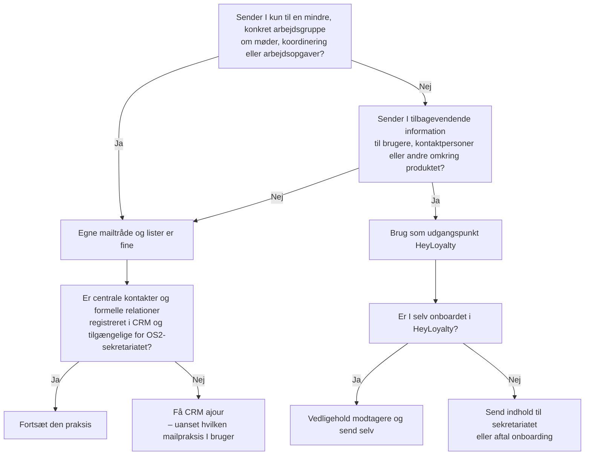

# Nyhedsbreve i OS2
{: .no_toc }

Denne side beskriver de fælles principper for produkt- og projektnyhedsbreve i OS2.

Nyhedsbreve bruges til at holde fællesskabet orienteret, skabe synlighed om produktet og gøre det muligt for interesserede at følge med og deltage.

Det er ikke et krav, at alle produkter og projekter løbende udsender nyhedsbreve. Men når der sendes tilbagevendende produktinformation til en bredere kreds, er HeyLoyalty OS2's fælles kanal.

## Indholdsfortegnelse
{: .no_toc .text-delta }

1. TOC
{:toc}

## Hvad bruger vi nyhedsbreve til?

Nyhedsbrevet er en direkte kanal til både mennesker, der allerede er en del af produktfællesskabet, og andre, der gerne vil følge med.

Det kan fx bruges til:

- releases og nye funktioner
- væsentlige ændringer
- arrangementer og aktiviteter
- erfaringer og cases fra anvendere
- nye organisationer eller personer i fællesskabet
- invitationer til at deltage i udvikling, arbejdsgrupper eller styring
- anden viden og produktnyt, som er relevant for en bredere kreds.

Et nyhedsbrev behøver ikke være en stor produktion. En enkelt relevant nyhed kan være nok.

## Nyhedsbrevet er som udgangspunkt en åben kanal

Produktnyhedsbrevet er ikke kun en kontaktliste for de personer, produktet allerede kender. Interesserede skal også kunne følge produktet og lære det bedre at kende.

Indholdet skal derfor som udgangspunkt kunne deles åbent.

Noget kan godt være mest relevant for fx brugere, kontaktpersoner eller styregruppen uden at være fortroligt. En invitation til et ERFA-møde for produktets brugere er fx stadig produktkommunikation, selv om arrangementet er for en afgrænset kreds.

Fortrolig, ufærdig eller konkret arbejdsdialog hører i stedet hjemme i relevante arbejdsfora.

## HeyLoyalty og egne maillister

Egne maillister er ikke et problem i sig selv. De kan være den letteste løsning til den løbende arbejdsdialog i en mindre, konkret gruppe.

| Egne maillister er fine til | Brug som udgangspunkt HeyLoyalty til |
| --- | --- |
| Mødeindkaldelser i en mindre arbejdsgruppe | Releases og væsentlige produktændringer |
| Koordinering og opfølgning på konkrete opgaver | Arrangementer og invitationer til brugere eller en bredere kreds |
| Arbejdsgrupper og konkrete arbejdsfora | Produktnyt og tilbagevendende information |
| Ad hoc-dialog mellem personer, der arbejder sammen | Kommunikation, som nye interesserede også skal kunne få adgang til |

Det afgørende er altså ikke, om modtagerne samarbejder. Samarbejde på tværs af myndigheder og brugere er en grundlæggende del af OS2.

Spørgsmålet er snarere, om I skriver til **en mindre gruppe, fordi den løser en konkret opgave sammen**, eller til mennesker **fordi de bruger, følger eller på anden måde har en relation til produktet**.

## CRM og HeyLoyalty har forskellige formål

OS2 har et fælles CRM, hvor produktets centrale kontakter og formelle relationer registreres. Det gælder uanset, hvordan produktet kommunikerer.

HeyLoyalty er ikke et CRM, men et værktøj til at sende og målrette kommunikation.

Der er dog et overlap: Når et produkt har en nyhedsbrevsliste i HeyLoyalty, skal de centrale personer omkring produktet – fx lokale kontaktpersoner samt medlemmer af styre- og koordinationsgruppen – også kunne nås gennem den.

## Hvornår bør I ændre jeres praksis?

Brug denne tommelfingerregel:

Det er værd at stoppe op og se på praksis igen, hvis:

- den samme produktinformation gentagne gange sendes via egne Outlook-lister
- centrale kontakter kun findes hos én person **og ikke er tilgængelige for OS2-sekretariatet**
- modtagergruppen vokser ud over en mindre, konkret arbejdsgruppe
- nye interesserede ikke har nogen enkel måde at følge produktet på
- en anden person ikke uden videre kan overtage kommunikationen
- det bliver uklart, hvilken af flere parallelle lister der er den rigtige.

## Hvorfor gør vi sådan?

Praksissen skal understøtte **åbenhed, samarbejde og kontinuitet**.

Når produktinformation kun sendes via egne maillister, når produktet primært de mennesker, man allerede kender. Nye interesserede har sværere ved at følge med, og kommunikationen kan blive afhængig af enkeltpersoner og deres egne arbejdsgange.

HeyLoyalty gør det muligt at opbygge en fælles modtagerkreds, hvor nye interesserede kan tilmelde sig, og hvor kommunikationen lettere kan videreføres ved personskifte.

Det handler derfor ikke kun om administration. En mere åben kommunikationspraksis gør det også lettere at:

- invitere nye mennesker ind i fællesskabet
- synliggøre produktets aktiviteter og resultater
- skabe interesse for arrangementer og samarbejde
- udbrede viden og erfaringer på tværs.

## Hvor meget ekstra kræver det?

Ofte mindre end man tror.

Hvis I allerede sender information via egne maillister, handler overgangen først og fremmest om **at flytte den eksisterende praksis over i HeyLoyalty** – ikke om at producere mere kommunikation.

I kan enten sende indholdet til OS2-sekretariatet eller blive onboardet, så I selv kan sende.

Når kommunikationsbehovet vokser, vil det ofte være mest hensigtsmæssigt, at en person omkring produktet lærer den grundlæggende brug af HeyLoyalty og bliver selvkørende.

Hvor meget I derudover vil gøre ud af nyhedsbrevet som aktiv kommunikationskanal, afhænger af produktets behov og ressourcer.

## Når I går fra egne maillister til HeyLoyalty

Overgangen behøver ikke ske på én gang.

Start med den kommunikation, I allerede sender til en bredere kreds, fx releases, produktnyt og invitationer.

Det betyder typisk, at I skal vænne jer til at:

- vedligeholde relevante modtagere i HeyLoyalty frem for kun på egne lister
- sende tilbagevendende produktinformation via HeyLoyalty
- fortsat bruge egne mailtråde til konkret arbejdsdialog og koordinering
- sikre, at kommunikationen kan videreføres af andre.

**Hvis I ikke selv er onboardet i HeyLoyalty:**  
I sender indholdet til OS2-sekretariatet, som hjælper med udsendelsen.

**Hvis I selv skal arbejde i HeyLoyalty:**  
En person omkring produktet onboardes og lærer den grundlæggende brug, så produktet selv kan vedligeholde modtagere og sende relevant information.

## Hvem har ansvaret?

Styregruppen prioriterer produktets samlede indsats og tager dermed også stilling til, hvor højt kommunikation skal prioriteres.

Det betyder ikke, at styregruppen skal skrive eller godkende hvert nyhedsbrev.

Produktet bør have en enkel aftale om:

- hvem der typisk skriver eller samler indhold
- hvem der sender
- hvem der vedligeholder relevante modtagere
- hvem der godkender, når det er nødvendigt.

OS2-sekretariatet stiller de fælles rammer og værktøjer til rådighed og hjælper med onboarding og sparring.

Målet er, at kommunikationspraksissen passer til produktets størrelse og behov – og samtidig er robust nok til ikke at være afhængig af én enkelt person.

## Hold det enkelt

Nyhedsbrevsarbejdet skal kunne fungere i praksis.

Derfor er udgangspunktet:

- send, når der er noget relevant at fortælle
- hold indholdet så kort som muligt
- brug som udgangspunkt én nyhedsbrevsliste
- målret kun, når der er et reelt behov
- genbrug relevant indhold på tværs af kanaler
- fordel arbejdet, så kommunikationen ikke bliver afhængig af én person.

Målet er ikke at sende mest muligt. Målet er at gøre det let for relevante mennesker at følge produktet og fællesskabet omkring det.

## Indhold til OS2's fælles kanaler

Relevant indhold fra produktfællesskaberne kan også bruges i OS2's fælles kommunikation, fx i OS2's nyhedsbrev, på hjemmesiden eller LinkedIn.

Har produktet en historie, aktivitet eller nyhed, som kan være relevant for en bredere del af OS2-fællesskabet, kan sekretariatet hjælpe med at vurdere, hvordan den bedst bringes videre.

---

🛠️ Skal du konkret skrive, sende eller administrere et nyhedsbrev? Brug **Nyhedsbreve** under værktøjskassen til praktiske vejledninger og skabeloner.

---

> **Opdateret november 2026:** Siden er forenklet og præciseret, så det er tydeligere, hvornår HeyLoyalty og egne maillister bruges, og hvordan praksissen understøtter åbenhed, kontinuitet og mindre personafhængighed.
---

🛠️ **Skal du arbejde konkret med nyhedsbreve nu?** Gå til [Værktøjskassen](../product_toolbox.html) for trin for trin, værktøjer og skabeloner.
