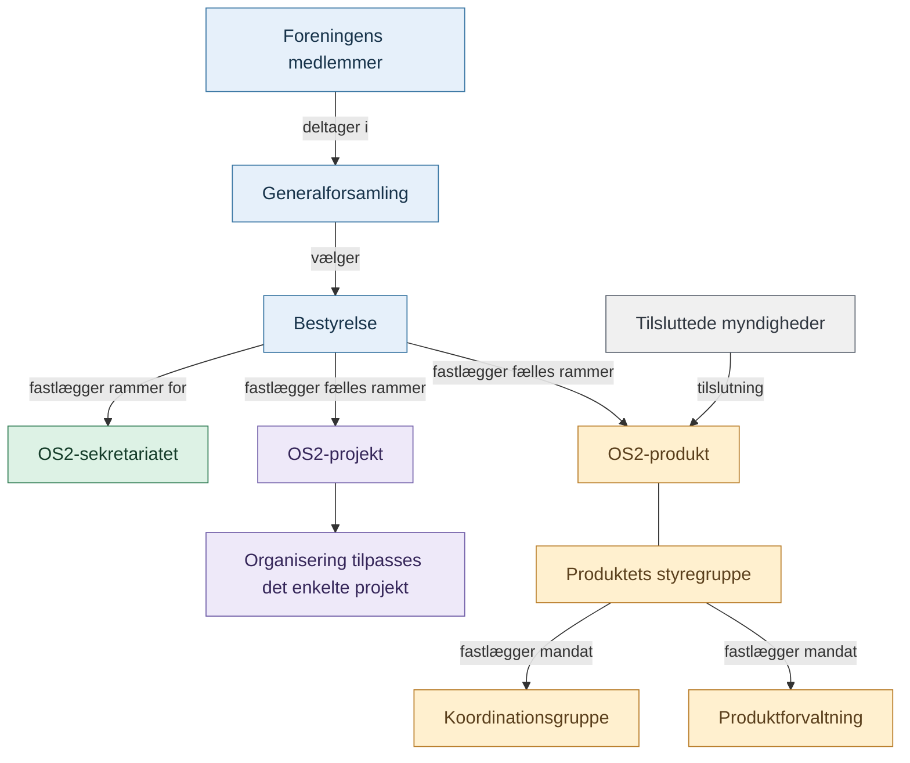
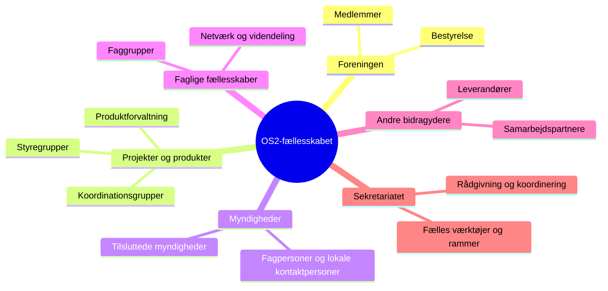

# Organisationsdiagram
{: .no_toc }

## Indholdsfortegnelse
{: .no_toc .text-delta }

1. TOC
{:toc}

## Organisering og ansvar

OS2 er organiseret som en forening med en generalforsamling, bestyrelse og et sekretariat. 

De enkelte OS2-produkter har deres egen organisering inden for OS2's fælles rammer. OS2-projekter kan være organiseret forskelligt afhængigt af projektets formål og udviklingsfase.

Diagrammet viser derfor den overordnede organisering og den typiske struktur omkring et OS2-produkt.

Medlemskab af foreningen og tilslutning til et bestemt produkt er to forskellige forhold.

## OS2 som fællesskab

OS2 er mere end en formel organisation. Fællesskabet bygger på samarbejde mellem offentlige myndigheder, produkt- og projektfællesskaber, leverandører og andre bidragydere.

Samarbejdet skaber mulighed for at dele viden, erfaringer og ressourcer – og udvikle og forvalte digitale løsninger i fællesskab.

Diagrammet illustrerer de forskellige dele af OS2-fællesskabet og deres bidrag. Det viser ikke formelle ledelses- eller ansvarsforhold.

