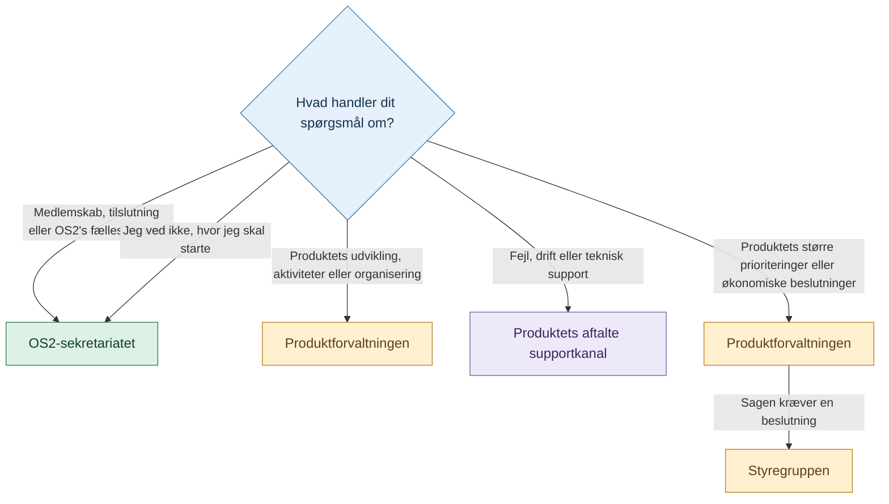

# Roller og ansvar
{: .no_toc }

OS2 består af en række aktører med forskellige roller og ansvar. Nogle arbejder med foreningens overordnede retning, mens andre har ansvar for konkrete projekter, produkter og fællesskaber.

Denne side giver overblik over de centrale roller, deres ansvar og samspillet mellem dem.

## Indholdsfortegnelse
{: .no_toc .text-delta }

1. TOC
{:toc}

## Formelle roller og ansvar

Tabellen giver overblik over de centrale roller og ansvarsforhold i OS2's organisering. 

| Aktør | Overordnet rolle og ansvar |
|---|---|
| **Foreningens medlemmer** | Har del i det fælles ejerskab af OS2 og den samlede portefølje. Udøver indflydelse på foreningsniveau gennem generalforsamlingen, herunder valg af bestyrelse. |
| **Generalforsamlingen** | Foreningens øverste myndighed. Træffer de beslutninger, der hører under generalforsamlingens mandat. |
| **OS2's bestyrelse** | Fastlægger foreningens strategiske retning og fælles rammer. |
| **OS2-sekretariatet** | Understøtter foreningen, medlemmerne og projekt- og produktfællesskaberne gennem administration, koordinering og rådgivning. |
| **Produktets styregruppe** | Har ansvar for produktets retning, økonomi og overordnede prioriteringer inden for sit mandat. |
| **Koordinationsgruppen** | Samler og kvalificerer faglige behov og understøtter prioritering og opfølgning inden for det mandat, styregruppen har fastlagt. |
| **Faggrupper** | Samler personer om faglige emner, videndeling og udvikling af viden. Kan være knyttet til et produkt eller arbejde på tværs af OS2. |
| **Produkt-/projektforvaltningen** | Varetager den løbende koordinering og forvaltning af produktet og fællesskabet omkring det. |
| **Tilsluttede myndigheder** | Har tilsluttet sig et OS2-produkt og bidrager økonomisk til produktfællesskabet. Tilslutningen giver mulighed for deltagelse og indflydelse på produktets udvikling og prioriteringer. |
| **Leverandører** | Bidrager blandt andet med udvikling, implementering, drift, support og teknisk rådgivning. |
| **Lokal kontaktperson** | Er kontaktpunkt mellem et OS2-produkt og den myndighed, der anvender produktet. |

## Hvad er en produktforvalter?

I OS2 er **produktforvalter en samlebetegnelse** for personer, der arbejder med den løbende forvaltning og udvikling af et OS2-produkt.

Betegnelsen kan dække over forskellige funktioner, eksempelvis:

- Product owner
- Produktkoordinator
- Community manager
- Projektleder
- Andre koordinerende eller produktansvarlige funktioner

De konkrete opgaver afhænger af produktets organisering, behov og ressourcer.

Produktforvaltningen kan blandt andet omfatte koordinering af udvikling og drift, samarbejde med leverandører, facilitering af produktfællesskabet og opfølgning på styregruppens beslutninger.

Det er derfor vigtigt at skelne mellem **produktforvaltningen som en samlet funktion** og de konkrete roller, der varetager opgaverne.

## Hvad er en lokal kontaktperson?

En lokal kontaktperson er den person i en deltagende myndighed, som OS2 og produktforvaltningen kan kontakte med information om et bestemt OS2-produkt.

Kontaktpersonen fungerer som bindeled mellem produktfællesskabet og den lokale organisation. Rollen handler blandt andet om at sikre, at relevant information når frem til de rette personer.

Produktforvaltningen koordinerer arbejdet omkring produktet på tværs af fællesskabet, mens den lokale kontaktperson er kontaktpunkt i sin egen organisation.

## Hvad er en faggruppe?

En faggruppe samler personer med fælles faglige interesser eller kompetencer omkring et bestemt emne.

Faggrupper bruges til at dele erfaringer, udvikle viden og kvalificere arbejdet i OS2. De kan være knyttet til et konkret projekt eller produkt, men kan også arbejde på tværs af OS2-fællesskabet.

En faggruppe er ikke det samme som en styregruppe eller koordinationsgruppe. Den bidrager med faglig viden og sparring, men har ikke automatisk beslutningsansvar.

## Anvendelse, tilslutning og deltagelse

Det er vigtigt at skelne mellem at anvende et OS2-produkt, være tilsluttet produktet og deltage aktivt i produktfællesskabet.

En myndighed kan anvende et OS2-produkt uden at være tilsluttet.

Tilsluttede myndigheder bidrager økonomisk og får mulighed for deltagelse og indflydelse gennem produktfællesskabets organisering.

Hvor aktivt en myndighed deltager, varierer. Nogle bidrager til styregrupper, koordinationsgrupper og udviklingsarbejde, mens andre primært anvender løsningen.

## Hvordan spiller rollerne sammen?

OS2's organisering bygger på en arbejdsdeling mellem foreningens fælles rammer og de enkelte produktfællesskabers ansvar.

**På foreningsniveau** fastlægger generalforsamlingen og bestyrelsen den overordnede retning og de fælles rammer. Sekretariatet understøtter arbejdet og skaber sammenhæng på tværs af OS2.

**På produktniveau** har styregruppen det overordnede ansvar for produktets retning og prioriteringer. Koordinationsgruppen bidrager med faglige behov og sparring, mens produktforvaltningen understøtter den løbende koordinering og opfølgning.

**I det daglige samarbejde** bidrager deltagende myndigheder, anvendere og leverandører med viden, erfaringer og leverancer.

Den konkrete opgavefordeling kan variere mellem produktfællesskaberne, men ansvar og beslutningskompetence skal være tydeligt placeret.

## Hvem kontakter jeg om hvad?

Er du i tvivl om, hvem du skal kontakte i OS2? Brug oversigten som udgangspunkt.

Kontaktoplysninger til de enkelte produkter finder du i [OS2's produktoversigt](https://www.os2.eu/os2-it-loesninger).

Produktforvaltningen kan hjælpe med at finde den rette vej videre i produktfællesskabet. OS2-sekretariatet kan hjælpe med spørgsmål om foreningens fælles rammer, medlemskab, tilslutning og mulighederne for støtte.